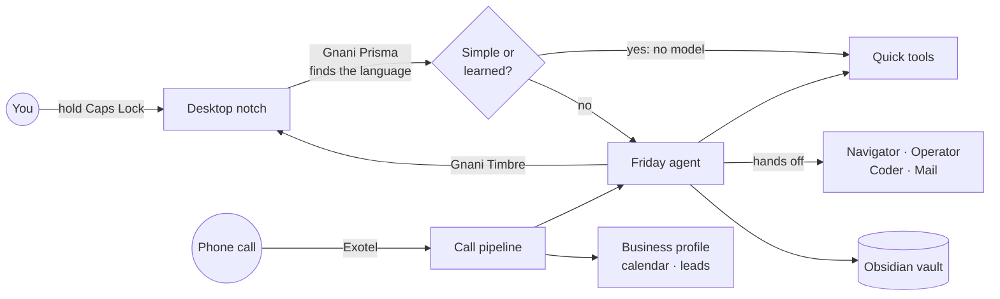

<div align="center">

# Friday

### The voice assistant that does the work, in your language.

Speak in English, Hindi, Hinglish or another Indian language. Friday understands which one it is, answers in it, and gets the job done on your PC, your phone and your phone calls.


Built for the **Gnani AI #GreatIndianAIInternshipChallenge** by **Prem and Aarohi**

[Solution](#the-solution) · [Features](#what-friday-can-do) · [Architecture](#architecture) · [Getting started](#getting-started) · [One-page pitch](PITCH.md)

</div>

---

## The problem

Computers still expect people to know which app to open, where a setting lives and how to type in English. For millions of Indians, that is the barrier to using technology at all.

Most voice assistants stop at answering questions. They rarely finish a task across apps, the browser and the phone. Small businesses face the same gap from the other side: they lose customers because nobody can answer every call, in every language.

## The solution

<div align="center">

[](PITCH.md)

**[Open the one-page solution pitch](PITCH.md)**: the problem, the solution, the technology and what comes next, on a single page.

</div>

Friday lives in a small notch above the Windows taskbar. Hold Caps Lock, say what you need, and Friday hears your language, replies in it out loud, and does the work.

| For                  | What Friday changes                                                                            |
| -------------------- | ---------------------------------------------------------------------------------------------- |
| **Everyday users**   | A computer you can use by talking, without knowing menus or typing English                     |
| **Elders**           | Reminders, messages and calls by voice, in their own language                                  |
| **Students**         | Background research with sources, meeting notes, and coding practice                           |
| **Small businesses** | Client calls in the client's language, meetings booked into the calendar, and every lead saved |

## What Friday can do

| Area                   | Capabilities                                                                                                                                   |
| ---------------------- | ---------------------------------------------------------------------------------------------------------------------------------------------- |
| **Conversation**       | Streams its reply sentence by sentence, stops when you talk over it, and answers small talk at once with no model call                         |
| **Your PC**            | Opens and types into apps, arranges windows across screens, controls media and volume, finds files, reads what is on screen                    |
| **The web**            | Multi-step browser tasks you can watch, and background research reports with sources                                                           |
| **Your Android phone** | Opens apps and reads the screen over USB                                                                                                       |
| **Messages and mail**  | WhatsApp messages and calls, Gmail summaries and drafts, Calendar and Drive                                                                    |
| **Phone calls**        | Places and answers real calls on an Indian number, reports outcomes with a transcript                                                          |
| **Business**           | Sales, follow-up and meeting calls, a client dashboard grouped by region, leads and booked meetings                                            |
| **Memory**             | Remembers what matters as Markdown notes in a private Obsidian vault, and searches them for context                                            |
| **Learning**           | A task done once replays instantly. Teach your own: "When I say focus mode, open Spotify and put Chrome on the left."                          |
| **On-screen help**     | "Show me where" points at a control, meeting notes run during a call, dictation types into any app, and saved friends are recognised on device |
| **Watching**           | "Tell me when the download is done": Friday watches the window and speaks up                                                                   |

### Languages

Friday uses Gnani Prisma's automatic language detection, so nobody has to choose a language first. It follows the speaker from turn to turn, including mixes such as Tamil and English.

English · हिन्दी · मराठी · தமிழ் · తెలుగు · ಕನ್ನಡ · മലയാളം · বাংলা · ગુજરાતી · ਪੰਜਾਬੀ

## Architecture



Friday is a team of agents. The one you talk to does quick jobs itself and hands bigger ones to a helper, which works in the background while you keep talking.

| Agent         | Job                                                              |
| ------------- | ---------------------------------------------------------------- |
| **Friday**    | Talks with you, does one-step jobs and delegates the rest        |
| **Navigator** | Plans and carries out multi-step web tasks                       |
| **Operator**  | Works Windows apps through UI Automation                         |
| **Coder**     | Solves problems on coding practice sites                         |
| **Mail**      | Reads and organises Gmail; drafts wait for your approval         |
| **Reception** | Takes a message from callers who are not you, and shares nothing |

### Technology

| Layer           | Used                                                                              |
| --------------- | --------------------------------------------------------------------------------- |
| Speech to text  | Gnani Prisma, streaming, with `indic-auto` language detection                     |
| Text to speech  | Gnani Timbre v3.0, one voice across every language                                |
| Language model  | Gnani Evon or any OpenAI-compatible model, with automatic failover between models |
| Voice pipeline  | Pipecat, WebRTC, Silero VAD, offline Vosk wake word                               |
| Agent platform  | Multi-agent runtime, TypeScript, Node.js, MCP                                     |
| Services        | Python, FastAPI                                                                   |
| Desktop and web | Electron, React, Vite                                                             |
| Browser         | Hermes Agent, ego lite, Obscura for background research                           |
| Phone           | Exotel and ngrok for calls, phone-harness over ADB for Android                    |
| Memory          | Obsidian-compatible Markdown vault                                                |
| Integrations    | Composio for Gmail, Calendar and Drive; WhatsApp Desktop                          |

## Safety and privacy

- Messages, emails and calls to other people are read back, and go only after your yes.
- Helpers refuse password, card and OTP fields, never pay and never accept terms.
- Browser helpers work in their own profile or Space, separate from your personal browsing.
- Saying "stop", "ruko" or "bas" halts every on-screen action.
- Callers other than you never reach your details, contacts or tools.
- On business calls, Friday states that it is an AI and says only what the business profile contains. It never takes card, UPI or OTP details.
- Memories, contacts and call records stay on your PC. Keys live in `.env`, which is never committed.

## Getting started

### Prerequisites

- Windows, **Node.js 24+**, npm, Python and [uv](https://docs.astral.sh/uv/) (`python -m pip install uv`)
- Google Chrome, and WhatsApp Desktop signed in to your account
- A Gnani API key and a model endpoint
- A free CopilotKit account for conversation storage: `npx copilotkit@latest login`, then `npx copilotkit@latest project select`

Keep the project folder **outside OneDrive**, because syncing interferes with the dependencies and the database.

### Install

```sh
npm ci
cd friday/services; python -m uv sync; cd ../..
cd friday/hermes-agent; python -m uv sync; cd ../..   # Navigator's browser engine
cd friday/browser-agent; python -m uv sync; cd ../..  # optional fallback
cd friday/desktop; npm install; npm run install-shortcuts; cd ../..
```

### Configure

Copy `.env.example` to `.env` and fill in at least:

| Variable                                      | Purpose                                                     |
| --------------------------------------------- | ----------------------------------------------------------- |
| `GNANI_API_KEY`                               | Gnani speech (Prisma and Timbre)                            |
| `EVON_BASE_URL`, `EVON_API_KEY`, `EVON_MODEL` | The language model                                          |
| `FRIDAY_OWNER_NAME`, `FRIDAY_OWNER_PHONE`     | Your name and number                                        |
| `FRIDAY_SERVICES_TOKEN`                       | Any long random string shared by the app and services       |
| `FRIDAY_TTS_MODEL`, `FRIDAY_VOICE`            | `timbre-v3.0` and `Shivani` for one voice in every language |
| `FRIDAY_FALLBACK_*`, `FRIDAY_PRIMARY_*`       | Optional: a backup model, and extra keys or models          |
| `EXOTEL_*`, `NGROK_*`                         | Optional: phone calls                                       |

`.env.example` documents every other setting.

### Run

Double-click **`Start Friday.cmd`** from File Explorer. It starts the notch, the app and the services. Or, in two terminals:

```sh
npm run dev               # the app
npm run friday:services   # browser, apps, WhatsApp, live voice
```

The first time, and after each update, register the agents and their tools:

```sh
npm run friday:setup
```

Then hold **Caps Lock** in any app and speak. Ctrl + Caps Lock hides or shows the notch.

### Try saying

- "Open Notepad and write my shopping list: milk, eggs, bread."
- "YouTube pe lofi chalao aur Chrome ko left mein rakh do."
- "உங்களால் நாளைய meeting நேரம் சொல்ல முடியுமா?"
- "WhatsApp Priya that I'm running ten minutes late."
- "Remember that I prefer window seats."
- "When I say study time, open Notepad and play lofi on YouTube."
- "Tell me when Chrome shows Download complete."

### Pages

| Page                             | Address                          |
| -------------------------------- | -------------------------------- |
| Main page                        | http://localhost:5173/           |
| Voice screen                     | http://localhost:5173/#/friday   |
| Business dashboard               | http://localhost:5173/#/business |
| Admin: live status of every API  | http://localhost:5173/#/admin    |
| Agent dashboard and classic chat | http://localhost:5173/#/chat     |
| Services health                  | http://127.0.0.1:8765/health     |

## Phone calls and business

With an Exotel number and an ngrok domain in `.env`, Friday places and answers real calls. Setup is step by step in [friday/README.md](friday/README.md#call-friday).

- **Friday calls for you:** "Call the clinic and book a check-up at 6 PM." It says it is an AI assistant, keeps to the goal and reports the outcome.
- **Friday calls you:** when you ask, and before deadlines. You can give it tasks on the call.
- **Callers:** your own number gets the full assistant; anyone else gets Reception, which takes a message.

**For a business,** describe what you sell in [friday/business.md](friday/business.md). A made-up example, [friday/business.demo.md](friday/business.demo.md), is included for demonstrations. Add clients on the dashboard and press Call, or say "call this client to follow up". Set `FRIDAY_BUSINESS=true` to have the business assistant answer incoming calls too.

## Project layout

| Path                                | Contents                                                       |
| ----------------------------------- | -------------------------------------------------------------- |
| `src/friday/client/`                | Notch, voice screen, main page, admin and business dashboards  |
| `src/friday/server/`                | Model settings, failover, voice, hand-offs, memory             |
| `src/server/`, `src/client/`        | Agent runtime, chat and workspace                              |
| `friday/services/`                  | Python services: browser, desktop, WhatsApp, calls, live voice |
| `friday/desktop/`                   | The desktop notch app                                          |
| `friday/hermes-agent/`              | Navigator's browser engine                                     |
| `friday/persona.md`, `friday/dots/` | Personas for each agent                                        |
| `friday/docs/ARCHITECTURE.md`       | Design notes                                                   |
| `tests/`, `friday/services/tests/`  | Tests                                                          |

## Testing

```sh
npm run typecheck; npx vitest run tests/friday
cd friday/services; python -m uv run pytest; cd ../..
cd friday/hermes-agent; python -m uv run pytest
```
