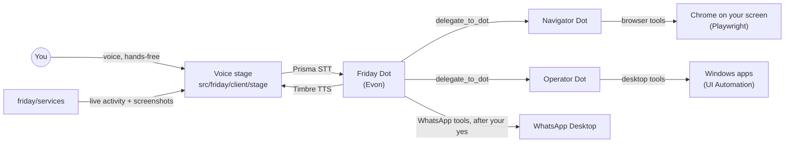
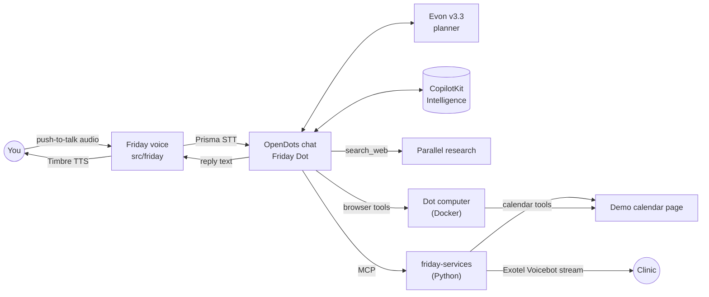

# Friday architecture

Status: **approved 22 Oct 2026, built 22 Oct 2026.** Changes since approval: Telegram dropped at the owner's request; Pipecat pinned to 1.5.x; the calendar has MCP tools as a no-Docker fallback. Findings come from reading OpenDots at commit `ab39f25` (15 Oct 2026) and the Gnani docs on 22 Oct 2026.

## Current design (23 Oct 2026)

The owner redirected Friday from phone calls to doing tasks on their own PC. The current shape:



- Helpers run in their own conversations through OpenDots' headless turn, so they cannot show approval cards. Their browser and desktop tools therefore run without "Ask first". WhatsApp send and call stay with Friday, behind an approval card that can be answered by voice.
- `friday/services` hosts the MCP endpoints `/browser`, `/desktop` and `/whatsapp`, plus `/activity/stream` (SSE with screenshots) and `/activity/stop`. Playwright and UI Automation each run on their own thread.
- The phone-call and Telegram sections below are history. The calling code remains in `friday_services/calls`, parked.

## What OpenDots already gives us

| Area          | How OpenDots does it                                                                                                                                                                                                                                                                                                           | What it means for Friday                                                                                                                      |
| ------------- | ------------------------------------------------------------------------------------------------------------------------------------------------------------------------------------------------------------------------------------------------------------------------------------------------------------------------------ | --------------------------------------------------------------------------------------------------------------------------------------------- |
| Model         | `OPENAI_BASE_URL`, `OPENAI_API_KEY`, `OPENAI_MODEL`. TanStack AI's OpenAI-compatible adapter on the **chat completions** API, streamed, with native function calling ([dot-agent.ts:332](../../src/server/dot-agent.ts)). Up to 5 tool rounds per turn, 90 s per turn (`AGENT_RUN_TIMEOUT_MS`). Sends `max_completion_tokens`. | Evon plugs in through env vars alone, if [test-evon-tools.mjs](../scripts/test-evon-tools.mjs) passes.                                        |
| Voice         | OpenAI Realtime over WebRTC, hard-coded to `api.openai.com` ([voice.ts:113](../../src/server/voice.ts)). A separate OpenAI speech-to-speech model does the talking and hands work to the Dot through an `ask_compute` tool.                                                                                                    | There is no STT/TTS slot to fill. Swapping in Gnani means **replacing** this path, not configuring it.                                        |
| Conversations | CopilotKit Intelligence is required for every chat, voice and scheduled turn. Options: hosted (CopilotKit cloud, free Developer plan), or local evaluation, which is **macOS only** (its CLI does not run on Windows).                                                                                                         | On this Windows machine Friday uses **hosted Intelligence**. Conversation history is stored in CopilotKit's cloud.                            |
| Custom tools  | Two ways: (a) an MCP server added per Dot in the UI (Streamable HTTP + bearer token), or (b) code tools in `dot-agent.ts`. MCP tools that are not read-only get an **Approve & run** card. MCP calls time out after **60 s**. Approval cards only appear in web chat, not in headless, scheduled or voice-delegated turns.     | Friday's skills are MCP tools: separate code, approval cards for free. Anything slow (a phone call) must return quickly and be checked later. |
| Research      | Parallel search MCP by default; anonymous use is free for light use. `search_web` returns source URLs and the prompt already asks for citations.                                                                                                                                                                               | Works as is.                                                                                                                                  |
| Browser       | Dot computers: an OpenBot container per Dot, run through Docker.                                                                                                                                                                                                                                                               | Docker Desktop and WSL2 are installed on this machine; Docker needs to be running.                                                            |
| Time          | The prompt gives the current time in UTC.                                                                                                                                                                                                                                                                                      | Friday needs Asia/Kolkata.                                                                                                                    |

## Design



### 1. Model: Evon through OpenDots' existing settings

`OPENAI_BASE_URL`, `OPENAI_API_KEY` and `OPENAI_MODEL` point at Evon. No code change unless the test shows a gap. The likely gaps are a rejected `max_completion_tokens` and Evon's thinking mode, which is on by default and adds latency. Either one gets a small adapter option.

### 2. Voice for talking to Friday: speech in, speech out, through the normal chat

- Push-to-talk records in the browser and posts the clip to `/api/friday/voice/stt`. The server calls Prisma, because Prisma's realtime socket needs an auth header that browsers can't set.
- The transcript is sent as an **ordinary chat message**. The reply text goes to `/api/friday/voice/tts`, Timbre returns audio, and the browser plays it.
- Going through normal chat keeps approval cards, tool cards and the live step view working with no extra effort. OpenAI's realtime path is switched off.
- Streaming later: a server-side WebSocket proxy to Prisma's realtime endpoint (`wss://api.vachana.ai/stt/v3/stream`) and Timbre's SSE stream.
- Language: `en-IN` by default (handles Hinglish). Switching to `hi-IN`, `kn-IN` and others picks the matching Timbre v2.5 voice.

### 3. Calling: a Python service, exposed to Friday over MCP

- Pipecat pipeline per call: Exotel's Voicebot stream (16-bit PCM, 8 kHz) → Gnani streaming STT at 8 kHz → Evon (thinking off) → Timbre → Exotel.
- **Change from the original spec:** OpenDots stops MCP calls after 60 s, and a phone call lasts minutes. So `make_call` becomes two tools:
  - `start_call(phone, goal, language, context)` returns a `call_id` straight away. It needs owner approval.
  - `get_call_result(call_id)` is read-only. It waits up to about 40 s, then returns `{ status: in_progress | answered | no_answer | failed, outcome, summary, transcript, latency_ms }`.
- Latency is logged per turn, from the end of the other person's speech to Friday's first audio. The target is under about 2 s; Prisma's silence window (`x-min-silence-ms`) is the main lever.

### 4. Telegram: dropped for now

The owner decided Friday should focus on voice, research and browser work.

### 5. Browser and research

- The Dot computer opens the demo calendar page served by friday-services at `/calendar` (plain HTML, clearly labelled fields) and adds the event. The container reaches the host as `host.docker.internal`, so the services must listen on `0.0.0.0` for this.
- Without a Dot computer, the `calendar` MCP endpoint's `add_event` (asks first) does the same; `list_events` (read-only) confirms either way.
- Research stays on Parallel; the persona asks for compared options, checked details and source links.
- A live step strip above the composer shows research, call, browser, calendar and approval steps as tool results arrive.

## File plan

Friday's code lives in two clearly named places. Any edit to an upstream OpenDots file is small, marked `// FRIDAY:`, and listed in `friday/CHANGES-TO-OPENDOTS.md`.

```
friday/ (repo root, fork of CopilotKit/OpenDots, MIT)
├── friday/
│   ├── README.md, CHANGES-TO-OPENDOTS.md, persona.md, docs/ARCHITECTURE.md
│   ├── scripts/
│   │   ├── test-evon-tools.mjs   Evon tool-call check
│   │   ├── test-research.ts      one research query through Parallel
│   │   ├── setup-friday-dot.mjs  creates Friday, browser permission, MCP connections
│   │   └── check-services.mjs    lists the services' tools as OpenDots sees them
│   └── services/                 Python 3.12 (uv)
│       ├── friday_services/main.py           FastAPI: Exotel call audio, MCP mounts
│       ├── friday_services/calls/            Pipecat pipeline, prompts, store, Exotel helpers
│       ├── friday_services/calendar/         demo calendar page and store
│       ├── friday_services/mcp_phone.py      start_call, get_call_result
│       ├── friday_services/mcp_calendar.py   list_events, add_event
│       └── tests/
├── src/friday/
│   ├── server/   config, time, agent limits, Gnani client, voice routes, speech text
│   ├── shared/   voices (languages and Timbre voices)
│   └── client/   FridayVoice (push-to-talk), FridaySteps (live steps), recorder, WAV
├── tests/friday/                 tests for src/friday and the persona
└── src/...                       OpenDots, with small marked edits only
```

App TypeScript sits in `src/friday/` because OpenDots compiles the server with `rootDir: src`. Code placed outside `src` would need build changes.

## Open items for later phases

- Evon endpoint, key and model id come from the challenge dashboard. No public hosted Evon API was found.
- Python 3.14 is installed. The Pipecat plugin is tested with Python 3.10+ and Pipecat 1.5, so the services use Python 3.12 through uv to be safe.
- Voice turns that go through normal chat need the browser open. Scheduled or headless turns can't show approval cards, so they can't start calls.
