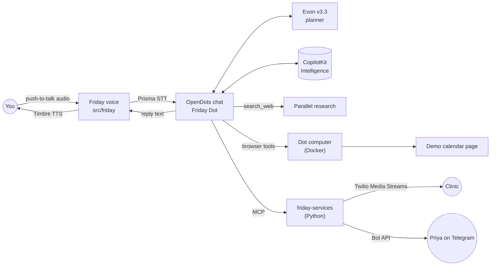

# Friday architecture

Status: **approved 22 Oct 2026.** Findings come from reading OpenDots at commit `ab39f25` (15 Oct 2026) and the Gnani docs on 22 Oct 2026.

## What OpenDots already gives us

| Area | How OpenDots does it | What it means for Friday |
| --- | --- | --- |
| Model | `OPENAI_BASE_URL`, `OPENAI_API_KEY`, `OPENAI_MODEL`. TanStack AI's OpenAI-compatible adapter on the **chat completions** API, streamed, with native function calling ([dot-agent.ts:332](../../src/server/dot-agent.ts)). Up to 5 tool rounds per turn, 90 s per turn (`AGENT_RUN_TIMEOUT_MS`). Sends `max_completion_tokens`. | Evon plugs in through env vars alone, if [test-evon-tools.mjs](../scripts/test-evon-tools.mjs) passes. |
| Voice | OpenAI Realtime over WebRTC, hard-coded to `api.openai.com` ([voice.ts:113](../../src/server/voice.ts)). A separate OpenAI speech-to-speech model does the talking and hands work to the Dot through an `ask_compute` tool. | There is no STT/TTS slot to fill. Swapping in Gnani means **replacing** this path, not configuring it. |
| Conversations | CopilotKit Intelligence is required for every chat, voice and scheduled turn. Options: hosted (CopilotKit cloud, free Developer plan), or local evaluation, which is **macOS only** (its CLI does not run on Windows). | On this Windows machine Friday uses **hosted Intelligence**. Conversation history is stored in CopilotKit's cloud. |
| Custom tools | Two ways: (a) an MCP server added per Dot in the UI (Streamable HTTP + bearer token), or (b) code tools in `dot-agent.ts`. MCP tools that are not read-only get an **Approve & run** card. MCP calls time out after **60 s**. Approval cards only appear in web chat, not in headless, scheduled or voice-delegated turns. | Friday's skills are MCP tools: separate code, approval cards for free. Anything slow (a phone call) must return quickly and be checked later. |
| Research | Parallel search MCP by default; anonymous use is free for light use. `search_web` returns source URLs and the prompt already asks for citations. | Works as is. |
| Browser | Dot computers: an OpenBot container per Dot, run through Docker. | Docker Desktop and WSL2 are installed on this machine; Docker needs to be running. |
| Time | The prompt gives the current time in UTC. | Friday needs Asia/Kolkata. |

## Proposed design



### 1. Model: Evon through OpenDots' existing settings
`OPENAI_BASE_URL`, `OPENAI_API_KEY` and `OPENAI_MODEL` point at Evon. No code change unless the test shows a gap. The likely gaps are a rejected `max_completion_tokens` and Evon's thinking mode, which is on by default and adds latency. Either one gets a small adapter option.

### 2. Voice for talking to Friday: speech in, speech out, through the normal chat
- Push-to-talk records in the browser and posts the clip to `/api/friday/voice/stt`. The server calls Prisma, because Prisma's realtime socket needs an auth header that browsers can't set.
- The transcript is sent as an **ordinary chat message**. The reply text goes to `/api/friday/voice/tts`, Timbre returns audio, and the browser plays it.
- Going through normal chat keeps approval cards, tool cards and the live step view working with no extra effort. OpenAI's realtime path is switched off.
- Streaming later: a server-side WebSocket proxy to Prisma's realtime endpoint (`wss://api.vachana.ai/stt/v3/stream`) and Timbre's SSE stream.
- Language: `en-IN` by default (handles Hinglish). Switching to `hi-IN`, `kn-IN` and others picks the matching Timbre v2.5 voice.

### 3. Calling: a Python service, exposed to Friday over MCP
- Pipecat pipeline per call: Twilio Media Streams (μ-law 8 kHz) → Gnani streaming STT at 8 kHz → Evon (thinking off) → Timbre (μ-law) → Twilio.
- **Change from the original spec:** OpenDots stops MCP calls after 60 s, and a phone call lasts minutes. So `make_call` becomes two tools:
  - `start_call(phone, goal, language, context)` returns a `call_id` straight away. It needs owner approval.
  - `get_call_result(call_id)` is read-only. It waits up to about 40 s, then returns `{ status: in_progress | answered | no_answer | failed, outcome, summary, transcript, latency_ms }`.
- Latency is logged per turn, from the end of the other person's speech to Friday's first audio. The target is under about 2 s; Prisma's silence window (`x-min-silence-ms`) is the main lever.

### 4. Telegram: same Python service, its own MCP endpoint
- Tools: `send_message(contact, text)`, which needs approval, plus `get_replies(contact)` and `list_contacts`, which are read-only.
- A contact is registered (name → chat id) when they press Start on the bot. Friday's memory holds aliases such as "Priya = my sister".

### 5. Browser and research
- The Dot computer opens a small demo calendar page served by friday-services and adds the event.
- If OpenBot or Docker is a problem on Windows, the fallback is a Playwright MCP tool.
- Research stays on Parallel.

## File plan

Friday's code lives in two clearly named places. Any edit to an upstream OpenDots file is small, marked `// FRIDAY:`, and listed in `friday/CHANGES-TO-OPENDOTS.md`.

```
OpenDots/                        fork of CopilotKit/OpenDots (MIT)
├── friday/                      everything Friday adds that is not app TypeScript
│   ├── README.md                what Friday is, setup, Gnani model map, OpenDots credit
│   ├── CHANGES-TO-OPENDOTS.md   every upstream file touched, and why
│   ├── docs/ARCHITECTURE.md     this file
│   ├── scripts/                 one standalone check per skill
│   │   ├── test-evon-tools.mjs  done in Phase 1
│   │   ├── test-gnani-stt.mjs   Phase 4
│   │   ├── test-gnani-tts.mjs   Phase 4
│   │   └── setup-friday-dot.mjs Phase 2: creates the Friday Dot and persona
│   └── services/                Python 3.12 (uv): calls, Telegram, demo page
│       ├── pyproject.toml
│       ├── friday_services/main.py       FastAPI: Twilio webhooks + MCP endpoints
│       ├── friday_services/calls/        Pipecat pipeline, call state, latency log
│       ├── friday_services/telegram/     Bot API client, contacts
│       ├── friday_services/demo_site/    calendar page for the browser task
│       └── tests/
├── src/friday/                  TypeScript that runs inside the OpenDots app
│   ├── server/gnani.ts          Prisma and Timbre clients
│   ├── server/voice-routes.ts   /api/friday/voice/*
│   └── client/useFridayVoice.ts push-to-talk hook for the call screen
├── src/...                      OpenDots, with small marked edits only
└── .env.example                 plus Friday's variables
```

App TypeScript sits in `src/friday/` because OpenDots compiles the server with `rootDir: src`. Code placed outside `src` would need build changes.

## Open items for later phases
- Evon endpoint, key and model id come from the challenge dashboard. No public hosted Evon API was found.
- Python 3.14 is installed. The Pipecat plugin is tested with Python 3.10+ and Pipecat 1.5, so the services use Python 3.12 through uv to be safe.
- Voice turns that go through normal chat need the browser open. Scheduled or headless turns can't show approval cards, so they can't start calls or send messages.
